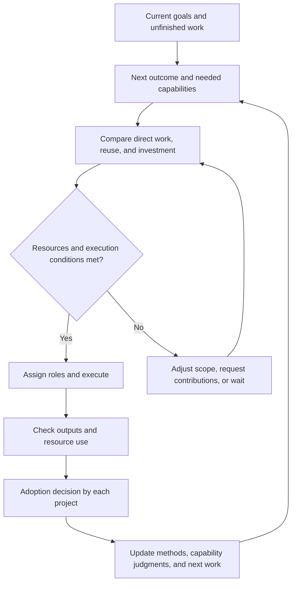

# Augnes Resource Operations and Agent Capability Growth Plan

**The goal is to complete current work within limited resources while expanding the range of work the project can perform later.** This plan connects resource operations, agent creation and lifecycle, discovery of shared needs, capability investment, cooperation, and the development of specialized roles and organizations.

**2026-11-07 KST · Supporting design / implementation candidate.** The first candidate starts from a shared need in two real tasks whose materials may be shared, produces a result through a selected method, and connects each consumer's use decision with any necessary follow-on execution. Implementation assignments and status remain with the existing GitHub roadmap and responsible issues.

This document develops the operating flow below as a supporting plan. Documents 01–04 in the [authority map](../00_AUGNES_VNEXT_DOCUMENT_INDEX.md) own product direction, Core and protocol semantics, implementation sequence, and evaluation criteria. When work is assigned, compare the proposed connections with the current implementation. Adding this document does not authorize a new execution assignment or resource expenditure.

## Operating flow

Start from the project's current goals, evidence, and unfinished work to identify the next useful outcome and missing capabilities. Compare direct execution, reuse of existing methods, method improvement, external contributions, and role assignment; then connect the selected approach with actual resources and authority. Each project assesses the result, and the experience informs later work and capability judgments.

Resume the flow when there is a reason to reconsider, such as a new request, changed relevant material, a returned result, or changed conditions of use. A continuing role can resume when needed without keeping a model running continuously. Repeated deliberation and inquiry remain within the existing work's resource limits.

## Proactive capability growth

| Direction | Concrete behavior | Change to examine |
| --- | --- | --- |
| Discover shared obstacles | Compare the inputs, outputs, and checking requirements of several tasks and propose common work. | Was useful shared work identified with actual consumers? |
| Understand the feasible scope | Distinguish outcomes currently achievable from those requiring more material or capability. | Did the expected prerequisites match actual execution? |
| Invest in capability | Compare the effects and burden of direct work, tool creation, method improvement, and external contributions. | Did later work change in quality, burden, or feasible scope? |
| Cooperate while retaining disagreement | Produce a shared output while each project judges it against its own purpose. | Was cooperation useful without requiring agreement between Perspectives? |
| Develop specialized roles and organizations | Propose a continuing role or independent service based on recurring demand and maintenance responsibility. | Do actual use relationships and operating resources continue? |

Identify shared needs from overlapping inputs, required outputs, and checking methods, rather than similar wording alone. If coordination is costly or requirements differ, narrow the common part or continue separate execution.

Assess capability investment separately for cost reduction, reliability improvement, new kinds of achievable work, lower cooperation burden, and additional future options. Base that assessment on actual or concretely planned later use. Do not count unlimited hypothetical reuse as realized savings.

## Execution proposal

Use one execution proposal to explain what should be done, why, and who will use the result. Connect the following information to existing work, proposals, selected materials, and result records. Choose any necessary persistence structure only after identifying the connections actual producers and consumers need.

| Item | Required information |
| --- | --- |
| Need to address | Blocked work or judgment, actual consumers, the current approach, and exact evidence versions |
| Expected change | The outcome to complete or the capability to make available through this work |
| Available approaches | Comparison of direct work, reuse, improvement, external contributions, reduced scope, and waiting |
| Resources and responsibility | Actual providers, limits and duration, enforcement coverage, and responsibility for checking, correction, and handoff |
| How to check | Outputs and observations that distinguish success, a useful negative result, failure, and uncertainty |
| Next decision | Conditions for retaining, improving, stopping, or expanding the approach after the result |

Separate observed facts, current expectations, and accepted commitments. An observation that two tasks repeat the same change check, an expectation that a common tool will reduce burden, and a provider's accepted commitment to supply resources within a limit and period are different information.

Continue choosing and executing an approach within already delegated purpose, authority, and resources. Refer decisions beyond that scope and unresolved material uncertainty to the responsible decision owner.

## Resource provision and operating agreements

Initial resources come from actual participants and sponsors. Execution may remain in the provider's supported environment while permitted state, results, and usage evidence connect to Augnes. The resource provider, cost bearer, executor, result consumer, and project direction decision owner may be different.

| Resource behavior | Examples | What to manage |
| --- | --- | --- |
| Consumable resources | API credits and paid-call budgets | Cumulative consumption and unconfirmed expenditure |
| Occupied capacity | GPUs, memory, and execution slots | Duration, occupancy, and release |
| Replenishing limits | Rate limits and periodic quotas | Recovery time and current availability |
| Reusable assets | Code, data, and methods | Applicability, use rights, and maintenance cost |
| Human availability | Review, approval, and troubleshooting | Actual available time and intervention burden |

For each resource, identify the provider, kind and unit, permitted purpose, duration and expiry, total limit, existing usage and outstanding reservations, usage evidence, and responsibility for stopping and settlement. Distinguish an offer from actual availability and a budget declaration from enforcement. Do not combine different providers or resource kinds into one balance.

Use the existing protocol's coverage levels: `enforced`, `observed`, `advisory`, and `outside_coverage`. These respectively mean actual prevention, reliable observation of use, guidance only, and activity beyond observation and control. The ability to cap call count does not establish a guarantee about account-wide charges.

For a consumable budget with the same provider, unit, and period, determine additional allocation from the effective limit after accounting for confirmed consumption, outstanding reservations including unconfirmed use, and protected capacity for checking and completion. Do not count the same usage twice as both a reservation and unconfirmed use. Attribute observed excess consumption to the original execution.

Occupied capacity instead depends on current occupancy and outstanding reservations; completed allocations do not continue consuming live slot capacity. Replenishing limits follow the provider's applicable time window and recovery rules, with late usage attributed to its original execution and applicable period. For reusable assets, assess rights, applicability, and maintenance; for human availability, assess available time and accepted obligations. These distinctions do not require a general resource calculator for the first case.

### Interruption and resumption

- Do not record missing usage results as zero. Link unconfirmed use and external effects to the original request and execution.
- Distinguish a cancellation request from confirmed termination. Release the part known to be unused and retain the uncertain part until it is reconciled.
- A successor executor carries forward existing consumption, reservations, and unfinished responsibilities. Creating another task or subordinate role does not enlarge the same budget.
- Attribute late results and usage to their original execution, preventing duplicate accounting and overwriting a new execution's state.
- When actual shared allocation is needed, implement atomic reservation or the provider's single allocation path, request identity and duplicate handling, cancellation, and settlement contracts.
- If uncertainty persists, restrict new allocation from the affected resource and identify the reconciliation owner. Independent work may continue under its own valid conditions.

### Responding to shortages

Account for checking, necessary correction, integration, and handoff as well as construction and execution. When resources become scarce, preserve the most useful current outcome by reducing scope, returning confirmed results and remaining questions, or waiting with clear resumption conditions.

Additional resources may arrive as execution capacity or as a completed contribution. A provider may perform a particular check in its own environment and return the result. Include the cost of checking and integrating external contributions, their use conditions, and later support responsibilities. Keep expected revenue and offers of support distinct from resources actually received.

## Agent creation and lifecycle

Agent creation here means defining a needed role, preparing material and methods, checking feasibility, and connecting responsibility and resources before assignment. Use an existing executor or tool when no new role is needed.

| Unit | What persists | What may change |
| --- | --- | --- |
| Project | Purpose, current judgments, assets, and accepted obligations | Members, sponsors, and execution approach |
| Continuing role and agent state | Assigned responsibilities, relevant experience, and unfinished work | Model and execution environment |
| Project assignment | Work scope, access rights, resource allocation, and return responsibilities | Duration and assignment conditions |
| Individual execution | Inputs, method version, actions, usage, and results | Newly constituted for each execution |

The creation output should include the role description, relevant state and selected material, methods and their applicability, current assignment and resource references, expected return, and checking responsibility. A successor executor must be able to read this material and take on the work.

| Situation | Lifecycle behavior |
| --- | --- |
| A new capability is needed | Compare existing executors, tools, and external contributions, then define any necessary role. |
| First assignment | Connect purpose, material, methods, resource limits, and return and checking responsibilities. |
| Work completes | Wait if continuing responsibilities remain; otherwise end the role. |
| Material, model, or environment changes | Check affected capabilities and methods and adjust the assignment. |
| Recurring demand decreases | Reduce or end the role and hand off remaining responsibilities. |
| Independent recurring demand emerges | Propose a separate maintenance role, service, or project when appropriate. |

Executor termination, role termination, and project termination are distinct. Unconfirmed usage and accepted delivery or correction obligations may remain after a role ends. When a separate service emerges, preserve the provenance of methods and experience and connect consumers, providers, and maintenance responsibility to the new activity. Original authority and resources are not copied with it.

## Evidence change checking as a first candidate

A first candidate is shared checking of changes to evidence referenced by research review and security advisory work. These domains are design examples; select actual ongoing work and result consumers when assigning the implementation.

The common function checks whether a source passage used by an earlier judgment has changed and returns candidate judgments for reconsideration with before-and-after evidence. Each task retains responsibility for final interpretation and adoption.

1. Identify which source passages supported which judgments in each task.
2. Find common requirements for inputs, returned results, and checking.
3. Compare direct completion of the current work, reuse of an existing tool, and construction of a small common method.
4. Connect actual resources and return responsibilities and produce a result through the selected approach.
5. Let each consumer adopt, adapt, hold, or decline the result and record its reason.
6. In necessary later work, let a fresh executor read the method's version, conditions, and limits and decide whether to use it.

| Observation | Possible research judgment | Possible security judgment |
| --- | --- | --- |
| A referenced passage changes | Treat it as wording clarification and retain the existing conclusion. | Reconsider the earlier assessment because affected-version conditions changed. |
| Only unrelated material changes | Further review may be unnecessary. | Further review may be unnecessary. |
| The current source cannot be retrieved | Preserve the inability to confirm currentness. | Preserve the inability to confirm currentness. |

Projects may agree that a common output is accurate while making different subsequent decisions. One consumer's adoption does not imply another's. An observed source change does not automatically invalidate the earlier conclusion.

A temporary role may develop and check the common method. Consider a continuing role when recurring maintenance demand is observed. Use the next separate task's outcome to narrow applicability, improve the method, or retain it unchanged when sufficient.

## First implementation scope and outputs

Start with two real tasks whose sharing is permitted, and connect one execution proposal through to actual result use in a complete assignment. One actual provider and sequential execution can be sufficient initially. State which limits are enforceable and which activity can only be observed.

If no shared need exists, retain the reason and continue the individual tasks. Starting from two tasks in the same project establishes only that bounded function. Independent-project cooperation requires actual participants and suitable conditions.

The first outputs include:

- The needs and consumers of the two actual tasks, with evidence references
- An execution proposal comparing direct work, reuse, and capability investment
- The selected execution approach connected to actual resources and roles
- Checkable outputs and usage evidence or explicitly unresolved usage
- Each consumer's adoption or non-use decision
- Method conditions, limits, and remaining responsibilities usable by the next executor

Reuse existing read, write, and execution paths where they suffice. Identify the missing producer-to-consumer connection and implement necessary changes in one coherent PR. Completion of a general agent-creation service or shared resource market is not a prerequisite.

## Verification and actual usefulness

| Situation | Behavior to check |
| --- | --- |
| Similar wording but different requirements | Avoid common execution or narrow the shared part. |
| An actual shared need | Propose execution grounded in evidence and actual consumers. |
| One consumer adopts and another declines | Preserve each decision and its reasons independently. |
| Interrupted execution or unconfirmed usage | Resume while preserving existing consumption, reservations, and responsibilities. |
| Relevant evidence and unrelated material change | Reconsider affected judgments while retaining unrelated ones. |
| A fresh executor takes on later work | Actually read and use saved results and conditions. |

When shared allocation is implemented, also check competing requests for duplicate allocation, repeated request identity, and late results or usage after cancellation. Select checks needed for the actual change and reuse existing evidence where it answers the question.

Separate functional correctness, appropriateness of judgment, experience contribution to later work, and actual usefulness. Compare with ordinary files, scripts, and existing execution approaches supplied with sufficient information. Include preparation, search, execution, checking, integration, maintenance, human relay, and intervention burden.

| Observed result | Supported interpretation |
| --- | --- |
| Role descriptions and methods are saved | The representation and preservation path works. |
| A fresh executor reads saved material and continues | Handoff and re-entry work. |
| A genuinely separate task uses the method or correctly identifies an exclusion | Evidence of conditional reuse or applicability judgment within the observed conditions. |
| Comparable work improves in quality, total burden, or feasible scope | Evidence of the corresponding capability or usefulness improvement under those conditions. |

Completing the first flow or delivering the same output to two consumers does not by itself establish cumulative capability growth. Repeated sessions or small variants of the original task do not establish separate-task use. Record whether shared-need discovery and method selection came from a human, an agent, or an existing rule before making an autonomy claim. These distinctions guide interpretation; they do not require an invented follow-up task or a comparative study for bounded functional completion.

Focus evaluation on actual adoption, explanation and relay needed for resumption, missed obligations and duplicate work, method use in the next separate task, and changes in feasible scope. Give the comparison approach access to the same relevant information. Do not count hypothetical future reuse or unobserved cost as realized savings.

## Connection to the existing development plan

| Responsibility | Connection to existing owners |
| --- | --- |
| Product direction | Connect to 01's continuing-work, participant-resource, and capability-expansion direction. |
| Semantics and contracts | 02 owns role and authority semantics, resource enforcement coverage, and any necessary reservation and settlement meaning. |
| Work using current material | Connect the proposal to L1's current-material reading, action selection, actual work, result-informed update, and fresh re-entry. |
| Experience and method reuse | Connect to L2's original experience, conditional method, separate-task use, and outcome-informed retention or revision. |
| Contribution and cooperation | Reuse existing request, return, checking, use-decision, and permitted-feedback paths within their supported scope. |
| Evaluation | Apply 04's functional, semantic, and total-burden comparison criteria. |

For implementation selection, distinguish the following scopes; 03 remains the owner of status and sequence.

| Scope | Boundary |
| --- | --- |
| Existing building blocks to reuse | Bounded request, selected-source, return, use-decision, and continuation paths, plus execution-choice preparation and declarative operating profiles. Check each surface's supported scope; these parts do not establish the complete L1 flow or a provider-enforced allocator. |
| The first case's missing connection | Select actual tasks, consumers, and a provider; inspect which connection is missing between existing paths and implement only what the case needs. This document does not assign that implementation. |
| Later expansion | Provider-backed shared reservation and settlement remain Later and require a concrete 02 contract and actual provider enforcement when needed. Continuing services and broader organizations depend on observed demand and responsibility; they are not prerequisites for the first case. |

Task owners define goals, scope, and acceptance criteria; contributors inspect current source and perform necessary implementation, verification, and PR preparation; reviewers independently assess the result. Preserve existing assignments and responsibility boundaries while connecting changes needed for the selected case. This document retains design rationale and links to existing owners; repository issues and PRs retain execution assignments and status.

## Conditions for expansion

| Next expansion | Required observations and conditions |
| --- | --- |
| Continuing maintenance role | Repeated use and actual maintenance responsibilities emerge. |
| External contribution | An independent participant's contribution is needed, with definable results, use conditions, and return responsibilities. |
| Shared resource allocation | An actual provider participates in reservation and enforcement, with recurring competing requests. |
| Independent specialized service | Multiple consumers show recurring demand, support burden, and available operating resources. |
| Resource acquisition and reinvestment | Actual resource inflows, goal progress, and remaining obligations can inform the next allocation. |

Expand according to observed need. Better models or tools may remove an earlier bottleneck and justify reducing roles or organizational structure. Assess the sustainability of research, creation, and public goods through participation and support appropriate to their purpose, rather than revenue as a universal criterion.

## Items to resolve for the next implementation

At assignment, select two actual tasks and their consumers, evidence and sharing scope, the existing approach to compare, the provider and enforcement coverage, and responsibility for checking and using results. Map these to current read, write, and execution paths and choose only the missing connection as implementation scope.

The first completion criterion is that saved material and actual results explain which shared need was addressed, which resources were used, what each consumer obtained, and what should change next. Any necessary successor executor must be able to continue from that material.

## Related plans and evidence

- [Product principles and participant-provided resources](../01_AUGNES_VNEXT_MASTERPLAN.md#participant-provided-resources-and-operating-costs)
- [Economic undertakings and cumulative capability](../01_AUGNES_VNEXT_MASTERPLAN.md#economic-undertakings-and-cumulative-capability)
- [Authority coverage](../02_AUGNES_VNEXT_ARCHITECTURE_AND_PROTOCOL.md#34-authority-coverage)
- [Existing development and operation sequence](../03_AUGNES_VNEXT_TRANSITION_ROADMAP.md#development-and-operation-sequence--2026-10-25)
- [L1 current-understanding-guided work and re-entry](../03_AUGNES_VNEXT_TRANSITION_ROADMAP.md#next-p3p4--current-understanding-guided-work-and-result-informed-re-entry)
- [Executable capability reuse from experience](../03_AUGNES_VNEXT_TRANSITION_ROADMAP.md#next-p4p5--executable-capability-reuse-from-experience-1373)
- [Evaluation of current-understanding-guided work](../04_AUGNES_VNEXT_EVALUATION_AND_MATURITY.md#current-understanding-guided-work-evidence)
- [Conditional capability and organization choice](../04_AUGNES_VNEXT_EVALUATION_AND_MATURITY.md#conditional-capability-and-organization-choice)
