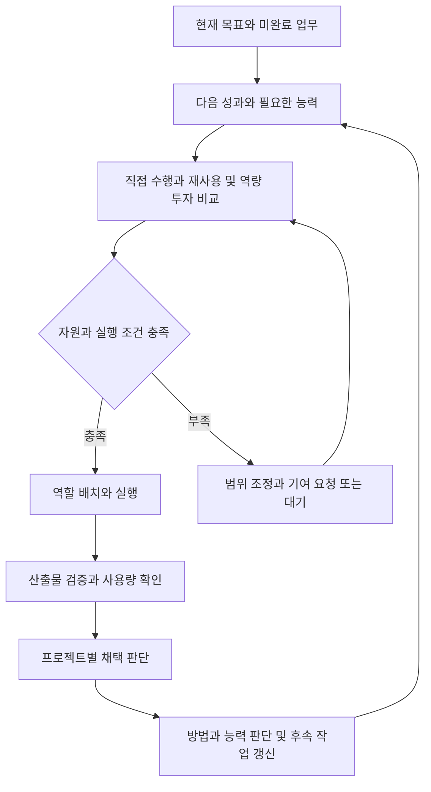

# Augnes 자원 운영과 에이전트 역량 성장 통합 계획

**목표는 제한된 자원 안에서 현재 업무를 완수하면서, 이후 수행할 수 있는 일의 범위를 넓히는 프로젝트 운영입니다.** 자원 운영, 에이전트 제조와 생애주기, 공통 수요 발견, 역량 투자, 협력과 전문 조직의 성장을 하나의 흐름으로 연결합니다.

**2026년 11월 7일 KST · 지원 설계안 / 구현 후보.** 첫 개발 후보는 공유가 허용된 실제 업무 두 개에서 공통 필요를 확인하고, 선택한 방법으로 결과를 만든 뒤, 각 소비자의 사용 판단과 필요한 후속 실행까지 연결하는 것입니다. 구현 배정과 진행 상태는 기존 GitHub 로드맵과 담당 이슈에서 관리합니다.

이 문서는 아래 운영 흐름을 구체화하는 지원 계획입니다. 제품 방향, Core·프로토콜 의미, 구현 순서, 평가의 정식 기준은 [권한 문서 지도](../00_AUGNES_VNEXT_DOCUMENT_INDEX.md)의 01–04가 담당합니다. 제안된 연결은 해당 업무가 배정될 때 현재 구현과 대조하며, 이 문서의 추가만으로 새 실행 배정이나 자원 지출이 승인되지는 않습니다.

## 운영 흐름

프로젝트의 현재 목표, 근거, 미완료 업무에서 다음 성과와 부족한 능력을 파악합니다. 직접 수행, 기존 방법 재사용, 방법 개선, 외부 기여, 역할 배치 중 적절한 실행안을 선택하고 실제 자원과 권한을 연결합니다. 결과를 각 프로젝트가 판단하고, 그 경험을 다음 작업과 능력 판단에 반영합니다.

새로운 요청, 관련 자료의 변경, 결과 반환, 사용 조건의 변화처럼 판단할 이유가 생겼을 때 흐름을 이어갑니다. 지속적인 역할은 필요할 때 재개할 수 있으며, 상시 모델 실행을 전제로 하지 않습니다. 반복 판단과 탐색에도 기존 작업의 자원 한도를 적용합니다.

## 능동적인 능력 성장

| 방향 | 구체적인 동작 | 확인할 변화 |
| --- | --- | --- |
| 공통 장애물 발견 | 여러 업무의 입력과 출력 및 검증 요구를 비교해 공동 과제를 제안합니다. | 실제 소비자가 있는 공통 작업을 찾았는지 확인합니다. |
| 가능한 일의 범위 파악 | 현재 가능한 결과와 추가 자료나 능력이 필요한 결과를 구분합니다. | 예상한 준비 조건이 실제 수행과 맞았는지 확인합니다. |
| 역량 투자 | 직접 처리와 도구 제작, 방법 개선, 외부 기여의 효과와 부담을 비교합니다. | 후속 업무의 품질과 부담 또는 수행 가능 범위가 달라졌는지 확인합니다. |
| 이견을 유지한 협력 | 공동 산출물을 만들고 각 프로젝트가 자기 목적에 따라 따로 판단합니다. | 관점의 합의 없이도 유용한 협력이 성립하는지 확인합니다. |
| 전문 역할과 조직의 성장 | 반복 수요와 유지 책임을 근거로 역할의 지속이나 서비스 독립을 제안합니다. | 실제 이용 관계와 운영 재원이 이어지는지 확인합니다. |

공통 수요는 비슷한 표현을 사용하는지보다 실제로 필요한 입력, 반환 결과, 확인 방법이 겹치는지를 기준으로 판단합니다. 공동화의 조정 비용이 크거나 요구 조건이 다르면 공통 부분을 좁히거나 개별 수행을 유지합니다.

역량 투자는 비용 절감, 신뢰성 개선, 새로운 종류의 업무 수행, 협력 부담 감소, 향후 대응 선택지 확보를 구분해 평가합니다. 실제로 예정되거나 발생한 후속 사용을 바탕으로 판단하며, 가상의 무한한 재사용을 비용 절감으로 계산하지 않습니다.

## 실행 제안의 구성

판단의 중심에는 무엇을 왜 수행하며 누가 결과를 사용할지를 설명하는 실행 제안 하나를 둡니다. 다음 정보는 기존 작업, 제안, 선택 자료, 결과 기록에 연결해 표현합니다. 실제 생산자와 소비자가 요구하는 연결을 확인한 뒤 필요한 저장 구조를 선택합니다.

| 항목 | 필요한 내용 |
| --- | --- |
| 해결할 필요 | 막힌 업무나 판단, 실제 소비자, 현재 대응 방법, 근거의 정확한 버전 |
| 기대하는 변화 | 이번 작업으로 완료할 성과 또는 새로 확보할 수행 능력 |
| 가능한 방법 | 직접 수행, 재사용, 개선, 외부 기여, 범위 축소와 대기의 비교 |
| 자원과 책임 | 실제 제공자, 한도와 기간, 통제 범위, 검증과 수정 및 인계 책임 |
| 확인 방법 | 성공, 유용한 부정 결과, 실패, 불확실을 구분할 산출물과 관측 |
| 후속 판단 | 결과에 따라 유지, 개선, 중단, 확대를 선택할 조건 |

확인한 사실, 현재 예상, 수락된 약속을 분리합니다. 예를 들어 두 업무가 같은 변경 확인을 반복한다는 관측, 공통 도구가 부담을 줄일 것이라는 예상, 제공자가 특정 한도와 기간의 자원을 제공하기로 한 약속은 각각 다른 정보입니다.

이미 위임된 목적, 권한, 자원 범위에서는 실행안 선택과 수행을 이어갑니다. 기존 범위를 넘어서는 결정과 해결하지 못한 중요한 불확실성은 해당 결정 책임자에게 연결합니다.

## 자원 제공과 운영 계약

초기 자원은 실제 참여자와 후원자가 제공합니다. 실행은 제공자의 지원되는 환경에서 수행할 수 있으며, Augnes에는 허용된 상태, 결과, 사용 증거를 연결합니다. 자원 제공자, 비용 부담자, 실행자, 결과 소비자, 프로젝트 방향 결정자는 서로 다를 수 있습니다.

| 자원의 성질 | 예시 | 관리할 내용 |
| --- | --- | --- |
| 소비되는 자원 | API 크레딧과 유료 호출 예산 | 누적 소비와 미확정 지출 |
| 점유하는 자원 | GPU와 메모리 및 실행 슬롯 | 사용 시간과 점유량 및 반환 |
| 회복되는 한도 | 호출 속도와 주기별 할당량 | 회복 시점과 현재 가용성 |
| 재사용 가능한 자산 | 코드와 데이터 및 방법 | 적용 조건과 사용 권리 및 유지 비용 |
| 사람의 참여 여력 | 검토와 승인 및 문제 해결 | 실제 가능한 시간과 개입 부담 |

자원별로 제공자, 종류와 단위, 허용 목적, 기간과 만료, 총한도, 기존 사용과 미해제 예약, 사용 증거, 중단과 정산 책임을 확인합니다. 제공 의사와 실제 가용량, 예산 선언과 실제 집행을 구분합니다. 서로 다른 제공자와 자원을 하나의 잔액으로 합치지 않습니다.

통제 범위는 기존 프로토콜의 `enforced`, `observed`, `advisory`, `outside_coverage`를 따릅니다. 각각 실제 차단 가능, 신뢰 가능한 사용 관찰, 안내만 가능, 관찰과 통제 범위 밖을 뜻합니다. 호출 횟수를 차단할 수 있다는 사실을 계정 전체 청구 금액의 보장으로 확대하지 않습니다.

같은 제공자와 단위 및 기간에서 추가 배정 가능량은 유효 한도에서 확정 사용량, 미확정 사용을 포함한 미해제 예약, 보호할 검증과 마무리 여력을 제외해 판단합니다. 동일한 사용분을 예약과 미확정 사용에 중복 산입하지 않으며, 실제 초과 사용이 확인되면 원래 실행에 귀속해 기록합니다.

### 중단과 재개

- 결과가 도착하지 않은 실행의 사용량을 0으로 처리하지 않습니다. 미확정 사용과 외부 효과를 원래 요청 및 실행에 연결합니다.
- 취소 요청과 실제 종료 확인을 구분합니다. 미사용이 확인된 부분을 반환하고 불명확한 부분은 확인될 때까지 보존합니다.
- 새 실행기는 기존 소비, 예약, 미완료 책임을 이어받습니다. 새 작업이나 하위 역할 생성으로 동일 예산이 늘어나지 않습니다.
- 늦게 도착한 결과와 사용량은 원래 실행에 귀속하며 중복 반영과 새 실행 상태의 덮어쓰기를 방지합니다.
- 실제 공유 배정이 필요해지면 원자적 예약 또는 제공자의 단일 배정 경로, 요청 식별과 중복 처리, 취소와 정산 계약을 구현합니다.
- 미확정 상태가 계속되면 해당 자원의 신규 배정을 제한하고 확인 책임을 연결합니다. 독립적으로 수행 가능한 업무는 자기 조건에 따라 계속할 수 있습니다.

### 자원 부족에 대한 대응

제작과 실행뿐 아니라 결과 검사, 필요한 수정, 통합, 인계에 쓸 여력을 함께 고려합니다. 부족해지면 현재 성과를 가장 잘 보존하는 방식으로 범위를 줄이거나, 확인된 결과와 남은 질문을 반환하거나, 재개 조건을 남기고 대기합니다.

추가 자원은 실행 용량 자체 또는 완성된 기여의 형태로 확보할 수 있습니다. 제공자가 자기 환경에서 특정 검증을 수행하고 결과를 반환하는 방식도 유효합니다. 외부 기여의 검사와 통합 비용, 이용 조건, 후속 지원 책임을 함께 고려합니다. 예상 수익과 후원 의사는 실제 유입으로 확인된 자원과 구분합니다.

## 에이전트 제조와 생애주기

에이전트 제조는 필요한 역할을 정의하고, 자료와 방법을 준비하고, 수행 가능성을 확인하고, 책임과 자원을 연결해 배치하는 과정으로 다룹니다. 새 역할이 필요하지 않으면 기존 실행기나 도구를 사용합니다.

| 단위 | 보존할 내용 | 바뀔 수 있는 내용 |
| --- | --- | --- |
| 프로젝트 | 목적, 현재 판단, 자산, 수락한 의무 | 구성원, 후원자, 실행 방식 |
| 지속 역할과 에이전트 상태 | 맡은 책임, 관련 경험, 미완료 업무 | 담당 모델과 실행 환경 |
| 프로젝트 배치 | 업무 범위, 접근 권한, 자원 할당, 반환 책임 | 기간과 배치 조건 |
| 개별 실행 | 입력, 방법 버전, 행동, 사용량, 결과 | 실행마다 새로 구성 |

제조 결과에는 역할 설명, 관련 상태와 선택 자료, 사용할 방법과 적용 조건, 현재 배치와 자원 참조, 반환할 결과와 검증 책임이 포함되어야 합니다. 다음 실행기가 이 자료를 읽고 업무를 맡을 수 있어야 합니다.

| 상황 | 생애주기 동작 |
| --- | --- |
| 새 능력이 필요함 | 기존 실행기와 도구 및 외부 기여를 비교하고 필요한 역할을 정의합니다. |
| 첫 배치 | 목적, 자료, 방법, 자원 한도, 반환과 검증 책임을 연결합니다. |
| 업무 완료 | 계속 맡을 책임이 있으면 대기하고, 없으면 역할을 종료합니다. |
| 자료와 모델 또는 환경 변경 | 영향을 받는 능력과 방법을 확인하고 배치를 조정합니다. |
| 반복 수요 감소 | 역할을 축소하거나 종료하고 남은 책임을 인계합니다. |
| 독립적인 반복 수요 발생 | 별도 유지 역할이나 서비스 또는 프로젝트로 운영할지 제안합니다. |

실행기 종료, 역할 종료, 프로젝트 종료는 별개입니다. 역할이 끝나도 미확정 사용량과 수락한 납품 또는 수정 책임은 남을 수 있습니다. 독립 서비스로 파생할 때는 방법과 경험의 출처를 보존하고, 소비자와 제공자 및 유지 책임을 새 활동에 연결합니다. 원래 권한과 자원이 복제되는 것으로 취급하지 않습니다.

## 첫 사례로 검토할 근거 변경 확인

연구 검토와 보안 공지 관리가 참조한 근거의 변경 여부를 함께 확인하는 사례를 첫 후보로 둡니다. 두 분야는 설계용 예시이며, 실제 착수 때는 현재 수행 중인 업무와 결과 소비자를 선택합니다.

공통 기능은 이전 판단이 참조한 원문 구절이 변경됐는지 확인하고, 재검토할 후보와 변경 전후 근거를 반환하는 것입니다. 최종 의미 해석과 채택은 각 업무가 맡습니다.

1. 각 업무가 어떤 원문 구절을 근거로 어떤 판단을 내렸는지 확인합니다.
2. 필요한 입력과 반환 결과 및 검증 방법의 공통 부분을 찾습니다.
3. 이번 업무의 직접 처리, 기존 도구 재사용, 작은 공통 방법 제작을 비교합니다.
4. 실제 자원과 반환 책임을 연결하고 선택한 방법으로 결과를 만듭니다.
5. 각 소비자가 채택, 수정 사용, 보류, 미사용을 판단하고 이유를 남깁니다.
6. 필요한 후속 업무에서 새 실행기가 방법의 버전과 조건 및 한계를 읽고 사용할지 결정합니다.

| 관측 | 연구 업무의 판단 예시 | 보안 업무의 판단 예시 |
| --- | --- | --- |
| 참조 구절 변경 | 표현 수정으로 판단해 기존 결론을 유지할 수 있습니다. | 영향 버전 조건의 변경으로 기존 판정을 재검토할 수 있습니다. |
| 관련 없는 부분만 변경 | 추가 검토가 필요하지 않을 수 있습니다. | 추가 검토가 필요하지 않을 수 있습니다. |
| 새 원문 확인 실패 | 현재성을 확인하지 못한 상태를 보존합니다. | 현재성을 확인하지 못한 상태를 보존합니다. |

공동 산출물의 정확성에 동의해도 각 프로젝트의 후속 판단은 달라질 수 있습니다. 한쪽의 채택으로 다른 쪽의 채택을 추정하지 않습니다. 원문이 바뀌었다는 관측을 기존 결론의 자동 무효화로 연결하지 않습니다.

공통 방법의 개발과 확인에는 한시적 역할을 배치할 수 있습니다. 반복적인 유지 수요가 확인되면 지속 역할을 검토합니다. 다음 별도 업무의 사용 결과로 적용 조건을 좁히거나 방법을 개선하고, 충분하면 그대로 유지합니다.

## 첫 구현 범위와 산출물

첫 개발은 공유가 허용된 실제 업무 두 개에서 출발해 하나의 실행안과 결과 사용까지 연결하는 완결된 작업으로 구성합니다. 실제 제공자 하나와 순차 실행으로 시작할 수 있으며, 통제 가능한 한도와 관찰만 가능한 범위를 명시합니다.

공통 필요가 없으면 그 근거를 남기고 개별 업무를 계속합니다. 같은 프로젝트 안의 두 업무로 시작할 경우에는 그 범위의 기능을 확인한 것으로 해석합니다. 독립 프로젝트 간 협력은 실제 참여와 조건이 갖춰졌을 때 확인합니다.

첫 산출물은 다음 내용을 포함합니다.

- 실제 업무 두 개의 필요와 소비자 및 근거 참조
- 직접 수행과 재사용 및 역량 투자 비교를 포함한 실행 제안
- 선택한 실행 방식과 실제 자원 및 역할 연결
- 검증 가능한 산출물과 사용량 또는 미확정 상태
- 소비자별 채택 또는 비사용 판단
- 다음 실행기가 사용할 방법의 조건과 한계 및 남은 책임

현재 읽기와 쓰기 및 실행 경로가 충족하는 부분은 재사용합니다. 부족한 생산자와 소비자 사이의 연결을 확인하고, 필요한 변경을 하나의 일관된 PR로 구현합니다. 일반적인 제조 서비스나 공유 자원 시장의 완성을 선행 조건으로 두지 않습니다.

## 검증과 실제 유용성

| 상황 | 확인할 동작 |
| --- | --- |
| 표현은 비슷하지만 요구가 다른 업무 | 공동화하지 않거나 공통 부분을 좁힙니다. |
| 실제 공통 필요가 있는 업무 | 근거와 소비자를 연결한 실행안을 제시합니다. |
| 한 소비자는 채택하고 다른 소비자는 거절 | 각 판단과 이유를 독립적으로 보존합니다. |
| 실행 중단 또는 사용량 미확정 | 기존 사용과 예약 및 책임을 보존하며 재개합니다. |
| 관련 근거와 무관한 자료가 각각 변경 | 영향을 받는 판단을 재검토하고 무관한 판단은 유지합니다. |
| 새 실행기가 후속 업무를 맡음 | 저장된 결과와 조건을 실제로 읽고 사용합니다. |

공유 배정을 구현하는 단계에서는 동시 요청의 중복 배정, 같은 요청의 반복, 취소 이후 늦은 사용량과 결과를 추가로 확인합니다. 해당 변경에 필요한 검증을 선택하고, 기존 증거가 답하는 질문은 재사용합니다.

기능의 정확성, 판단의 적절성, 경험의 후속 기여, 실제 유용성을 구분합니다. 일반 파일과 스크립트 및 충분한 정보를 가진 기존 실행 방식과 비교하고, 준비와 검색, 실행, 검증, 통합, 유지, 사람의 중계와 개입 부담을 함께 봅니다.

평가는 실제 채택 여부, 재개할 때 필요한 설명과 전달, 누락 의무와 중복 작업, 다음 별도 업무에서의 방법 사용, 수행 가능 범위의 변화에 초점을 둡니다. 같은 정보를 사용할 수 있는 비교 대안을 유지하고, 가상의 미래 재사용과 미관측 비용을 실제 절감으로 계산하지 않습니다.

## 기존 개발 계획과 연결

| 책임 | 기존 경로와 연결할 내용 |
| --- | --- |
| 제품 방향 | 01의 연속 업무와 참여자 자원 및 능력 확장 방향에 연결합니다. |
| 의미와 계약 | 02가 역할과 권한, 자원 통제 범위, 필요한 예약과 정산 의미를 맡습니다. |
| 현재 자료를 활용한 작업 | L1의 현재 자료 읽기, 행동 선택, 실제 작업, 결과 반영, 새 실행기의 재진입에 실행 제안을 연결합니다. |
| 경험과 방법 재사용 | L2의 원래 경험, 조건부 방법, 별도 업무 사용, 결과에 따른 유지와 수정에 연결합니다. |
| 기여와 협력 | 기존 요청과 반환, 검사와 사용 판단, 허용된 피드백 경로를 재사용합니다. |
| 평가 | 04의 기능과 의미 및 총부담 비교 기준을 적용합니다. |

ChatGPT는 목표와 범위 분석, 계획 구체화, 결과 검토를 맡고 Codex는 현재 소스를 확인해 필요한 구현과 검증 및 PR 작성을 수행합니다. 기존 과제와 담당 범위를 유지하면서 이번 사례에 필요한 변경을 연결합니다. 이 문서는 설계 이유와 기존 책임의 연결을 보존하고, 실행 배정과 상태는 저장소의 담당 이슈 및 PR을 따릅니다.

## 확장 조건

| 다음 확장 | 필요한 관측과 조건 |
| --- | --- |
| 지속 유지 역할 | 반복 사용과 실제 유지 책임이 생깁니다. |
| 외부 기여 연결 | 독립 참여자의 기여가 필요하고 결과와 이용 조건 및 반환 책임을 정할 수 있습니다. |
| 공유 자원 배분 | 실제 제공자가 예약과 집행에 참여하고 반복적인 경쟁 요청이 생깁니다. |
| 전문 서비스 독립 | 여러 소비자의 반복 수요와 지원 부담 및 운영 재원이 확인됩니다. |
| 자원 획득과 재투자 | 실제 자원 유입과 목표 진전 및 남은 의무를 확인하고 다음 배정을 판단할 수 있습니다. |

단계 확장은 관측된 필요를 따릅니다. 더 나은 모델이나 도구가 기존 병목을 해소하면 조직과 역할을 줄이는 선택도 가능합니다. 연구, 창작, 공공재의 지속성은 목적에 맞는 참여와 후원으로 평가하며 매출만을 공통 기준으로 삼지 않습니다.

## 다음 개발을 구체화할 항목

착수할 때는 실제 업무와 소비자 두 곳, 각 근거와 공유 범위, 비교할 기존 수행 방식, 사용할 제공자와 통제 범위, 결과의 검증과 사용 책임을 확정합니다. 이어 기존 읽기와 쓰기 및 실행 경로에 대응시켜 부족한 연결만 구현 범위로 선택합니다.

첫 완료 기준은 어떤 필요를 함께 해결했고, 어떤 자원을 사용했으며, 각 소비자가 무엇을 얻었고, 다음에는 무엇을 달리해야 하는지를 저장된 자료와 실제 결과로 설명할 수 있는 것입니다. 필요한 새 실행기는 같은 자료에서 업무를 이어갈 수 있어야 합니다.

## 관련 계획과 근거

- [제품 원칙과 참여자 제공 자원](../01_AUGNES_VNEXT_MASTERPLAN.md#participant-provided-resources-and-operating-costs)
- [경제 활동과 누적 능력](../01_AUGNES_VNEXT_MASTERPLAN.md#economic-undertakings-and-cumulative-capability)
- [권한 통제 범위](../02_AUGNES_VNEXT_ARCHITECTURE_AND_PROTOCOL.md#34-authority-coverage)
- [기존 개발과 운영 순서](../03_AUGNES_VNEXT_TRANSITION_ROADMAP.md#development-and-operation-sequence--2026-10-25)
- [L1 현재 이해에 따른 작업과 재진입](../03_AUGNES_VNEXT_TRANSITION_ROADMAP.md#next-p3p4--current-understanding-guided-work-and-result-informed-re-entry)
- [경험의 실행 가능한 방법 재사용](../03_AUGNES_VNEXT_TRANSITION_ROADMAP.md#next-p4p5--executable-capability-reuse-from-experience-1373)
- [현재 이해에 따른 작업의 평가](../04_AUGNES_VNEXT_EVALUATION_AND_MATURITY.md#current-understanding-guided-work-evidence)
- [조건에 따른 능력과 조직 선택의 평가](../04_AUGNES_VNEXT_EVALUATION_AND_MATURITY.md#conditional-capability-and-organization-choice)
